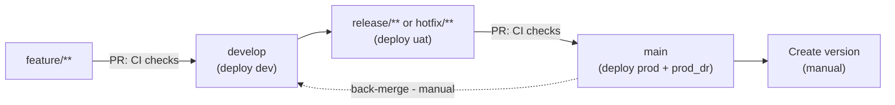

# Azure Function Repository


## FlexboxCgGhaFuncPython

Azure Function project generated for python with GitHub Actions CI/CD.

## Generated configuration

- Project name: `FlexboxCgGhaFuncPython`
- Project environments: `dev,uat,prod`
- Function language: `python`
- Python version: `3.12`
- Initialize Function project: `True`
- GitHub administrators team: `flexbox-cg-gha-func-python-admins`
- GitHub developers team: `flexbox-cg-gha-func-python-developers`

`CODEOWNERS` uses the configured team values. The language and runtime values determine the Function build steps. `Initialize Function project` records whether Azure Functions Core Tools initialized the project.


## Repository structure

```
FlexboxCgGhaFuncPython/
|-- .github/
|   `-- workflows/              # CI/CD workflows
|-- <function files>            # Azure Function code (depends on selected language)
|-- .pre-commit-config.yaml
|-- CODEOWNERS
|-- GitVersion.yml
`-- README.md
```

## CI/CD integration

- GitHub Environments: `dev`, `uat`, `prod`, and `prod_dr` (created for provisioned environments; `prod_dr` is always created)
- Deployment runner: organization runner group `devx-pgi` (`devx-pgi-dr` for `prod_dr`) with label `pg-pgi-4gb-1cpu`
- Shared actions: `procter-gamble/da-pp-pda-github-actions`
- Authentication: GitHub OIDC without an Azure client secret

Repository variables control automatic deployments. Workflows are generated for `dev,uat,prod` regardless of which environments exist today; `CICD_DEPLOY_<ENV>_ENABLED` is `true` only for provisioned environments.

### Repository variables

- `AZURE_TENANT_ID`: Entra tenant shared by all environments
- `CICD_DEPLOY_DEV_ENABLED`: development deployment
- `CICD_DEPLOY_UAT_ENABLED`: UAT deployment
- `CICD_DEPLOY_PROD_ENABLED`: production deployment
- `CICD_DEPLOY_PROD_DR_ENABLED`: production DR deployment
- `SONAR_PROJECT_KEY`: SonarQube project key for the scan

Only the exact lowercase value `true` enables a deployment.

### Environment variables

- `AZURE_CLIENT_ID`: client ID of the Entra ID application used by that environment
- `AZURE_SUBSCRIPTION_ID`: Azure subscription ID used for OIDC login
- `RESOURCE_GROUP`: resource group containing the Function App
- `FUNCTION_APP_NAME`: target Function App name

### Secrets

- `SONAR_TOKEN`: SonarQube authentication token

### Federated credentials

Each environment uses a federated credential provisioned on its client service principal. The GitHub environment selects the corresponding `AZURE_CLIENT_ID`, subscription, resource group, and Function App values. The authentication configuration is ready to use after provisioning.

Federated credential subject examples:

- Environment: `repo:ORGANIZATION/REPOSITORY:environment:dev`
- Branch: `repo:ORGANIZATION/REPOSITORY:ref:refs/heads/develop`
- Immutable environment: `repo:ORGANIZATION@ORGANIZATION_ID/REPOSITORY@REPOSITORY_ID:environment:dev`

The corresponding identity can deploy ZIP packages to the target Function App.

## Code analysis

CI runs a SonarQube scan on every build. The workflow does not run tests, so the scan reports issues and duplication but no coverage.

A ready-to-use `Run tests` step is already in `.github/workflows/ci-tasks.yml`, commented out in the `build` job between `Build application` and `Package artifact`. The properties the scan needs are listed as comments next to the `SonarQube scan` step. To enable it:

1. Add your tests under a `tests` folder. The step runs `python -m pytest`, which puts the repository root on `sys.path`, so tests can import your code from any folder.
2. Uncomment the `Run tests` step and replace `CODE_FOLDER` in `--cov=` with the folder holding the code your tests cover.
3. Move the commented properties above the `SonarQube scan` step into its `args` block:

```
-Dsonar.tests=tests
-Dsonar.python.coverage.reportPaths=coverage.xml
-Dsonar.python.xunit.reportPath=testresults.xml
```

Triggers in `function_app.py` need the Functions runtime to execute, so keep trigger bodies thin and put the logic in plain modules that tests can import directly. Run locally with `pip install pytest pytest-cov` and `python -m pytest --cov=CODE_FOLDER`.

The step runs before `Package artifact`, so a failing test stops the build before an artifact is published. The `tests` folder is already excluded from the deployment artifact and from `sonar.sources`; rename it in both places if you use a different name. Coverage only appears in SonarQube when the report is written before the scan runs and the path in the property matches the file the test tool actually produced.

## Workflow behavior

- `Pull Request Checks` (`ci-pull-requests.yml`): validates and builds pull requests to `main` or `develop`
- `Continuous Delivery` (`cd.yml`): runs validation and build once, then deploys only the enabled environments selected for the pushed branch
- `Reusable Validation and Build` (`ci-tasks.yml`): callable workflow used by pull request checks and continuous delivery; it does not run independently
- `Version Tagging` (`util-release-tag.yml`): manually calculates the next version and creates a Git tag and GitHub release; it does not deploy application code

Deployment routing after a successful artifact build:

- Push to `develop`: deploy to `dev` when enabled
- Push to `release/**` or `hotfix/**`: deploy to `uat` when enabled
- Push to `main`: deploy to `prod` and `prod_dr` independently when enabled; both run in parallel

The repository should ideally follow GitFlow: develop features through `feature/**` branches, integrate them into `develop`, stabilize releases through `release/**` or `hotfix/**`, and merge production-ready changes into `main`. Back-merge changes from `main` into `develop` after production or hotfix merges.

### Commit lifecycle

Each push triggers a deployment based on the branch. Pull requests to `develop` or `main` run CI checks. Creating a version is a separate manual step, and a back-merge from `main` into `develop` keeps the branches aligned.



- Merging into `develop` deploys `dev`; pushing `release/**` or `hotfix/**` deploys `uat`; merging into `main` deploys `prod` and `prod_dr` in parallel (each only when its variable is enabled).
- Versioning is manual: `util-release-tag.yml` calculates the next version and creates the tag and release. It does not deploy application code.
- After a production or hotfix merge, back-merge `main` into `develop` so both branches stay in sync.

CI stores `app-RUN_ID-COMMIT_SHA.zip` for 14 days in `artifact-RUN_ID-COMMIT_SHA`. CD deploys that ZIP with Azure CLI. GCHM is not used.

`GitVersion.yml` uses Git history. On `main`, it uses `ContinuousDeployment`, increments `Minor`, and ignores version directives in commit messages.

## Maintenance

Actions are pinned to commit SHAs for reproducibility and supply-chain security. Update pins through a reviewed pull request and test CI/CD. Template updates are not synchronized automatically.

Local validation:

`pre-commit run --all-files`

For skipped or queued deployments, check the deployment variable and the `pg-pgi-4gb-1cpu` runners in the `devx-pgi` group (`devx-pgi-dr` for `prod_dr`). For Azure failures, check environment values, the OIDC subject, resource names, and Azure permissions.